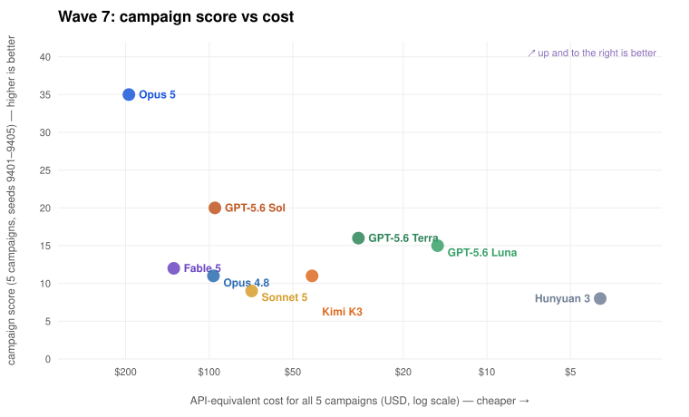
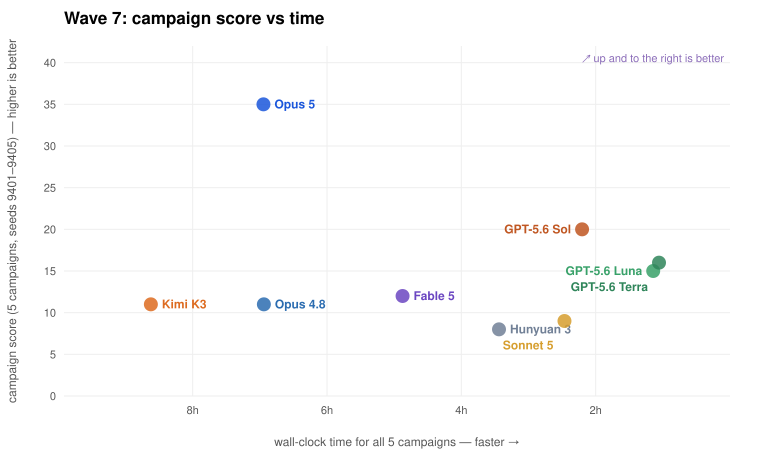
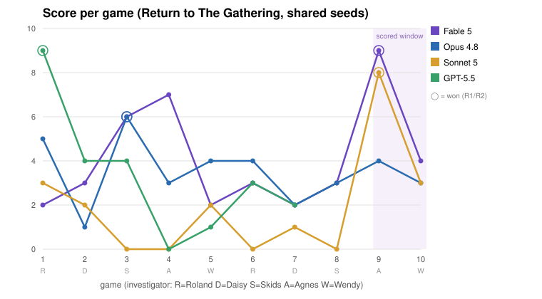
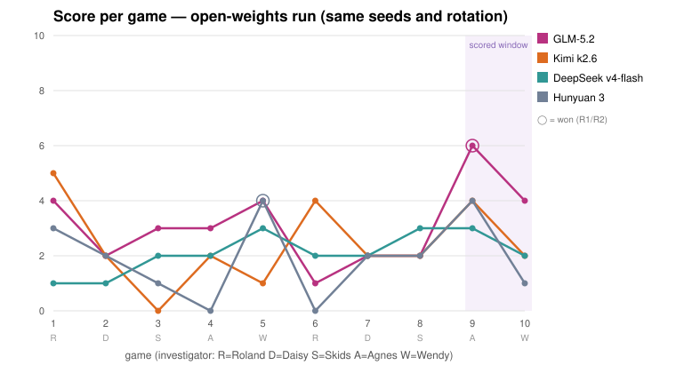
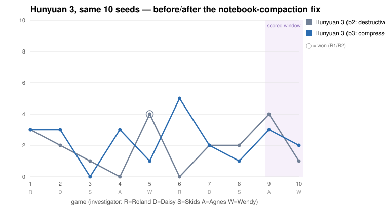

# ArkhamBench

**Live results:** [arkhambench.github.io/results.html](https://arkhambench.github.io/results.html)
-- leaderboard, cost/speed charts, and playtest findings . **[Run viewer](https://arkhambench.github.io)**

A rules-enforcing engine and CLI harness for benchmarking LLM agents on *Arkham Horror: The Card
Game* solo. Three research questions drive the design: **Can models play** a complex board game --
and how well? **Can they learn** from repeated play -- and how well? **Can they playtest** -- find
real rules bugs in the engine that hosts them -- and how well?

The engine covers "The Gathering" and "Return to The Gathering" (Night of the Zealot, Part I)
with all five core-set investigators, inside coding-agent harnesses, with a persistent and
compactable notebook. Built to reproduce Epoch AI's
[EBR-Bench continual-learning experiments](https://epoch.ai/publications/earthborne-rangers-benchmark)
with AHLCG.

---

## Repository layout

| Path | Purpose |
|------|---------|
| `DESIGN.md` | Full architecture and rules-scope specification |
| `arkham/` | Python engine package |
| `ahlcg` | Executable shim (`python3 -m arkham "$@"`) |
| `docs_agent/` | Rules reference, playing guide, and scenario reference given to playing agents |
| `data/` | Vendored card data (arkhamdb-json-data) and decklists |
| `scripts/` | Benchmark runners, audit drivers, deployment scripts |
| `viewer/` | Static web viewer for step-through game replays |
| `specs/` | Phase build specs and bug-adjudication ledger |
| `tests/` | Engine test suite |
| `bench/` | Benchmark output directories (gitignored for large runs) |
| `runs/` | Per-run game directories (gitignored) |

## Quickstart

```bash
./ahlcg new --run runs/mygame --seed 7         # set up The Gathering (Roland, standard)
./ahlcg new --run runs/mygame2 \
    --scenario return_to_the_gathering \
    --investigator agnes
./ahlcg state                                  # print the board
./ahlcg do 3                                   # pick option 3; prints events + next decision
./ahlcg score                                  # final result once GAME OVER
python3 -m unittest discover -s tests          # engine test suite (429 tests)
python3 -m arkham.fuzz --games 100 \
    --scenario return_to_the_gathering \
    --investigator wendy
```

```bash
# Let an agent play a full game
scripts/play_demo.sh claude-sonnet-5 my-demo 7

# Benchmark: Return to The Gathering, investigators rotate
# roland -> daisy -> skids -> agnes -> wendy per game
python3 scripts/bench.py \
    --agent claude-sonnet-5 --label mybench --games 10
```

Decks are killbray's
["Better Starter Decks"](https://arkhamdb.com/decklist/view/33937/better-starter-decks-roland-banks-1.0)
(30 cards + 2 signatures + a fixed basic weakness, revised-core pool), vendored in
`data/decks/killbray/`.

## Viewing games

```bash
scripts/view.sh bench/sonnet5-mini
open http://localhost:8765/viewer/
```

`scripts/view.sh` exports any passed bench or run directories not already in
`viewer/data/`, rebuilds the viewer index, caches card images, and serves the static UI
from the repo root. The viewer steps through every decision: location map with card art,
player board, event ticker, the decision presented with the agent's choice highlighted,
and double-sided card modals.

**Live viewer:** [arkhambench.github.io](https://arkhambench.github.io) -- redeploy with
`scripts/deploy_pages.sh` after exporting new runs.

---

## Scoring

Reported per run in `result.json`, alongside the raw dimensions:

- **XP** -- per the campaign guide: victory display total + resolution bonuses (+2 insight
  in most outcomes; +1 extra for the lead in R2; 0 if killed by agenda-out at act <= 2).
- **Trauma** -- defeat trauma (physical/mental by cause), resolution trauma (R1's burned
  house), Cover Up's game-end trauma.
- **Lita Chantler earned?** -- per the campaign guide she joins the campaign in every
  outcome except R2, so she is tracked as a campaign dimension rather than scored.
- **Resolution reached**, victory points, rounds, damage/horror per round, tests
  passed/failed, etc.

**Score = max(0, XP - trauma)**; killed by the agenda while still trapped (R3) scores 0.

---

## Wave 7 -- fully-instrumented campaign wave (2026-07-20/21)

Six subscription-tier frontier models, five full Return to Night of the Zealot campaigns
each (seeds 9401-9405, engine at 429 tests), with complete per-session telemetry:
thinking level, tokens, wall-clock time, and API-equivalent cost.

| Model (harness) | Thinking | R/D/S/A/W | **Total** | Wall clock | Tokens | API-equiv cost |
|---|---|---|---:|---:|---:|---:|
| **Opus 5** (claude) | adaptive | 12/3/7/7/6 | **35** | 6.9 h | 246.2 M | $194.63 |
| GPT-5.6 Sol (codex) | high | 5/3/5/3/4 | **20** | 2.2 h | 110.3 M | $95.37 |
| DeepSeek V4 Flash 0731 (opencode) | provider default | 8/0/3/4/4 | **19** | 6.4 h | 184.0 M | **$6.85**\* |
| GPT-5.6 Terra (codex) | high | 5/3/1/4/3 | **16** | 1.1 h | 68.2 M | $29.01 |
| GPT-5.6 Luna (codex) | high | 8/2/0/2/3 | **15** | 1.1 h | 81.6 M | **$15.05** |
| Fable 5 (claude) | adaptive | 5/1/1/2/3 | **12** | 4.9 h | 80.2 M | $134.15 |
| Opus 4.8 (claude) | adaptive | 4/1/0/1/5 | **11** | 6.9 h | 99.9 M | $96.55 |
| Kimi K3 (opencode) | provider default | 1/1/2/4/3 | **11** | 8.6 h | 90.5 M | $42.61\* |
| Sonnet 5 (claude) | adaptive | 1/2/1/3/2 | **9** | 2.5 h | 173.4 M | $70.32 |
| Hunyuan 3 (opencode) | provider default | 4/1/0/1/2 | **8** | 3.4 h | 59.2 M | $3.91\* |




**Launch-day addendum (July 24): Opus 5 rewrote the board.** Added under the identical
protocol the day Anthropic shipped it, Opus 5 scored **35** -- 75% above Sol's 20, with
seven R1 wins across the wave and a 12-point Roland campaign that is the best single
campaign ever recorded here. At $5/$25 it cost $195 -- double Sol, half of what Fable's
rate would have charged for this volume -- and even Opus 5 could not crack the Devourer
finale: all five investigators died, extending the streak to 0-for-50.

**Day-two addendum (Aug 1): DeepSeek V4 Flash 0731 is the value story of the board.**
Benched the day its weights reached third-party hosts, the new Flash build scored **19**
-- statistically Sol's 20, one point behind -- for **$6.85 of actual OpenRouter billing**,
fourteen times cheaper than Sol's API-equiv rate and the cheapest lane ever to crack
the board's top three. The pattern from the learning bench holds here too: strong
first-contact play, no measurable improvement across campaigns -- but at $0.14/M input,
this model moves the cost frontier by an order of magnitude.

### A note on token accounting

An earlier version of the table showed the GPT-5.6 lanes at ~3 M tokens -- an apparent
order of magnitude below everyone else. **That was a measurement error, not a real gap.**
The core mechanism: every agent harness here works the same way (one API call per tool
use, re-sending the conversation each time), so total token *flows* are dominated by
re-read context -- 95-99% of every lane's total was cached input. The meters just *report*
differently. Once all three are summed the same way -- every token that crossed the wire,
per call -- all eight lanes land in the same 59-173 M band.

The *real* structural difference is **context discipline**: codex holds its rolling
context to ~31-37 K tokens per call, while the claude lanes averaged 74-99 K per call.
**Cost** divides token flows by cache pricing, and there the spread is real: cached input
bills at ~0.1x on every provider, so what separates a $15 wave (Luna) from a $134 wave
(Fable) is mostly price-per-token.

---

## The learning bench -- modern engine (2026-07-25/27, b6)

Thirty games of the same scenario per model, identical shuffles (seeds 1001-1030), blank
starting notebooks, on the frozen modern engine -- with per-game token telemetry. Eleven
models completed the bench (330 games total).

| Model | Thinking | Mean | Final-6 avg | Slope/game | Wins | Time | Tokens | API-equiv cost |
|---|---|---:|---:|---:|---:|---:|---:|---:|
| Fable 5 | adaptive | **4.30** | 4.50 | +0.014 | 13 | 41.0 h | 725 M | $1,259 |
| GPT-5.6 Sol | high | 3.73 | 3.67 | -0.001 | 6 | 6.7 h | 406 M | $303 |
| Opus 5 | adaptive | 3.40 | 3.67 | -0.020 | 8 | 23.3 h | 1,228 M | $1,082 |
| GPT-5.6 Terra | high | 2.33 | 3.33 | +0.039 | 1 | 3.4 h | 212 M | $82 |
| Sonnet 5 | adaptive | 2.03 | 2.00 | -0.032 | 2 | 11.2 h | 920 M | $264 |
| GPT-5.6 Luna | high | 1.73 | 1.17 | -0.040 | 1 | 4.0 h | 295 M | $47 |
| Haiku 4.5 | adaptive | 1.13 | 1.00 | -0.012 | 0 | 1.9 h | 557 M | $78 |
| Hunyuan 3 | default | **3.37** | **5.00** | **+0.067** | 5 | 13.7 h | -- | $9.24\* |
| Kimi K3 | default | 2.83 | 3.50 | +0.011 | 4 | 21.8 h | -- | $103.58\* |
| GLM-5.2 | default | 2.83 | 3.00 | +0.048 | 4 | 15.9 h | -- | $44.77\* |
| DeepSeek V4 Flash 0731 | default | 2.50 | 2.50 | +0.001 | 3 | 11.1 h | -- | $8.47\* |

Three findings, stated plainly:

1. **Can they learn? Not measurably.** With three times the games of the original
   experiment and a far cleaner engine, every learning curve is flat: the steepest slope
   on the board (+0.039/game) is about one point of total drift across thirty games on a
   0-9 scale. Models play at their level from game one. Notebooks still transport
   *recipes* -- specific winning lines reappear -- but average skill does not rise.
2. **The single-scenario crown is Fable's, not Opus 5's.** Opus 5 dominated full
   campaigns (35 points); on the one-scenario gauntlet Fable 5's 4.30 mean and 13 wins
   lead. Different formats reward different play.
3. **The one learning curve that isn't flat belongs to the cheapest model.** Hunyuan 3
   posted the steepest slope on the board (+0.067/game), the best closing stretch of any
   model (final-6 average 5.00), five wins, and did it for $9.24 total -- cheaper than
   every other lane by 5x.
4. **Experience makes games costlier, not cheaper.** Because each game's lessons lengthen
   the notebook every later game must read, per-game cost *rose* for most models.

### The persistent-memory follow-up (2026-07-30, b7)

Rerunning the thirty games for one model per harness with a retained session (resumed
game-to-game), to test whether OpenAI's ARC-AGI-3 "retained reasoning + compaction"
result transfers.

| Model | Arm | Mean | Final-6 | Slope/game | Wins | Cost |
|---|---|---:|---:|---:|---:|---:|
| Fable 5 | fresh sessions (b6) | **4.30** | 4.50 | +0.014 | 13 | $1,259 |
| Fable 5 | retained session (b7) | 3.63 | 4.33 | -0.002 | 2 | $2,142 |
| GPT-5.6 Sol | fresh sessions (b6) | **3.73** | 3.67 | -0.001 | 6 | $303 |
| GPT-5.6 Sol | retained session (b7) | 3.43 | 3.67 | +0.047 | 6 | $244 |

**The verdict: no tripling.** Same thirty shuffles head-to-head, and the fresh-session
arm won more paired games than it lost for both models. The ARC result doesn't transfer
because the failure modes differ: ARC's harness wiped memory *mid-task* every move, while
the per-game sessions here were already continuity-complete.

---

## Benchmark results -- main run (2026-07-05)

Four agents, ten games each, *Return to The Gathering* on Standard, identical seeds
(1001-1010) and an identical interleaved investigator rotation. Each agent has a
persistent per-agent notebook as its only cross-game memory. The headline metric is the
**final-20% average** (games 9-10), per EBR-Bench methodology.



| Agent (harness) | Scores by game | Mean | **Final-20%** | Wins |
|---|---|---:|---:|---|
| Fable 5 (claude) | 2 3 6 7 2 3 2 3 **9** 4 | 4.10 | **6.50** | R1 g3, R2 g9 |
| Sonnet 5 (claude) | 3 2 0 0 2 0 1 0 **8** 3 | 1.90 | **5.50** | R2 g9 |
| GPT-5.5 (codex) | 9 4 4 0 1 3 2 6 **5** 3 | 3.70 | **4.00** | R2 g1, R2 g8 |
| Opus 4.8 (claude) | 5 1 6 3 4 4 2 3 4 3 | 3.50 | **3.50** | R1 g3 |

**Key findings:**

- No agent shows consistent improvement. Per-game variance dominates any learning signal.
- Notebooks transport *recipes*, not skill: both Claude scored-window wins executed a
  Priest-kill-then-R2 line their notebooks had described.
- GPT-5.5's opening game (a 9-point R2 win with an empty notebook) is the single best
  game of the benchmark -- and drives its *negative* slope, since nothing after matched it.

## Benchmark results -- open-weights run (2026-07-08)

Same 10-game gauntlet via OpenRouter + the opencode harness.



| Agent (harness) | Scores by game | Mean | **Final-20%** | Wins |
|---|---|---:|---:|---|
| GLM-5.2 (opencode) | 4 2 3 3 4 1 2 2 **6** 4 | 3.10 | **5.00** | R1 g9 |
| Kimi k2.6 (opencode) | 5 2 0 2 1 4 2 2 **4** 2 | 2.40 | **3.00** | -- |
| DeepSeek v4-flash (opencode) | 1 1 2 2 3 2 2 3 **3** 2 | 2.10 | **2.50** | -- |
| Hunyuan 3 (opencode) | 3 2 1 0 4 0 2 2 **4** 1 | 1.90 | **2.50** | R1 g5 |

GLM-5.2 is the open-weights standout -- third overall on the combined board, ahead of two
US frontier closed models.

## Benchmark results -- Kimi K3 (2026-07-16, launch day)

| Agent (harness) | Scores by game | Mean | **Final-20%** | Wins |
|---|---|---:|---:|---|
| Kimi K3 (opencode) | 3 3 3 3 4 6 3 2 **7** 4 | 3.80 | **5.50** | R2 g6, R2 g9 |

K3's final-20% of 5.50 ties Sonnet 5 for second overall (behind only Fable 5's 6.50).
The generational jump over k2.6 (+1.40 mean, +2.50 final-20%) is the largest
single-generation improvement measured here.

## Benchmark results -- GPT-5.6 family (2026-07-10)

| Agent (harness) | Scores by game | Mean | **Final-20%** | Wins |
|---|---|---:|---:|---|
| GPT-5.6 Sol (codex) | 2 2 4 0 4 3 2 2 **6** 3 | 2.80 | **4.50** | R1 g9 |
| GPT-5.6 Terra (codex) | 3 2 0 0 4 3 2 3 **4** 2 | 2.30 | **3.00** | -- |
| GPT-5.6 Luna (codex) | 4 2 2 1 3 1 2 2 **3** 3 | 2.30 | **3.00** | -- |

Terra and Luna are indistinguishable here despite a 2.5x price gap -- Luna is the value play.

---

## Wave 6 -- K3 audit trial (2026-07-18/19)

Three models played five full Return to Night of the Zealot campaigns each in parallel
lanes, and Kimi K3 audited all sixty artifacts. **K3 filed 40 findings: 23 confirmed,
17 refuted (57.5% precision)** -- more confirmed defects than any prior auditor tier.

Auditor board (confirmed/claims): GPT-5.6 Sol 18/21 (86%) . Fable 5 6/8 .
GPT-5.5 5/8 . Kimi K3 23/40 (58%) . Hunyuan 3 3/70 (4%).

All fifteen campaigns are browsable in the [viewer](https://arkhambench.github.io)
(model groups "-- w6"), and the findings page carries the full trial.

---

## The playtest benchmark

While building the engine, the bounty structure makes the benchmark self-healing: agents
are told verified engine-bug reports are worth more than score, making every adversary an
auditor. Across live hunts and transcript-audit passes, agents filed 24+ adjudicated
reports; **21 confirmed engine defects were found and fixed** before the main benchmark
ran -- including an engine-wide double-execution bug that unit tests, 200-game fuzzing,
and human review all missed.

**GPT-5.6 audit wave (2026-07-10):** Sol audited 28 playtest transcripts and raised 34
findings; adversarial verification confirmed **18 unique engine defects -- 86% auditor
precision**. All 18 were fixed with per-defect regression tests. The wave also completed
a 32/32 XP-card coverage disposition.

**Interactive findings page:** all benchmark results with every game linked to its
full replay -- [arkhambench.github.io/results.html](https://arkhambench.github.io/results.html)

Full adjudication record: [`specs/bug_adjudications.md`](specs/bug_adjudications.md).

---

## Case study: memory curation as the continual-learning bottleneck (hy3-b3)

A viewer review of Hunyuan 3's games caught it repeating game-1's exact death in game 6:
at "discard 1 random card OR take 2 horror" it chose the horror that had already killed
it once. Autopsy: hy3 read its notebook every game, the fix was in the notes -- but the
game-2 compaction had silently dropped every Roland lesson.

A/B probe on the reconstructed decision: with the notebook it actually saw, hy3 repeats
the fatal choice 5/5; with the lost lesson restored, it flips to discard 5/5. **The
model uses memories fine; it destroys them at curation time.**

The fix: `note compact` now documents that compact means *compress, not discard*, with
per-investigator lessons carried forward. Rerunning the identical gauntlet:



| Run | Mean | Final-20% | Paired 2nd-visit delta |
|---|---:|---:|---:|
| b2 (destructive compaction) | 1.90 | 2.50 | **-0.40** |
| b3 (compress-not-discard) | 2.30 | 2.50 | **+0.60** |

The meta-lesson: **retrieval and reasoning were never the problem -- memory management
was.** A one-line semantic contract on the compaction tool converted a
memory-destroying agent into a memory-preserving one.

---

## Development

```bash
python3 -m unittest discover -s tests          # run the full test suite
python3 -m arkham.fuzz --games 200             # randomized fuzz run
```

Card data (c) Fantasy Flight Games, via the community project
[arkhamdb-json-data](https://github.com/Kamalisk/arkhamdb-json-data). This project is for
AI-capabilities research and commentary; it does not distribute scans of the game.